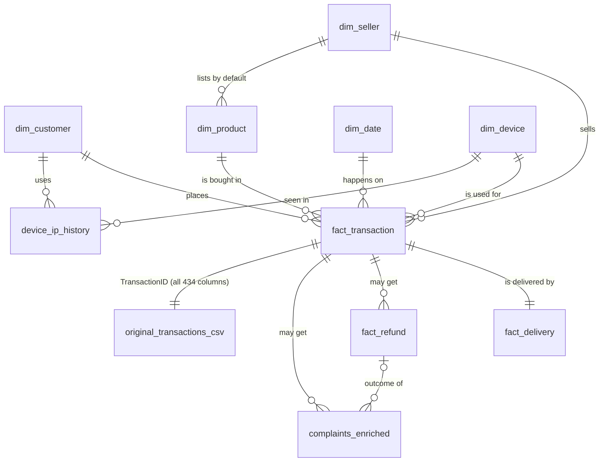

# AfriMarket star schema: data dictionary

The original `data/afrimarket_transactions.csv` uses anonymous columns (card1, C1–C14,
V1–V339, id_01 …), and `TransactionDT` only counts seconds. This branch adds a readable,
connected database around it. Nothing in the original files is changed: every new table
links back by `TransactionID`, so the existing model, producer and Spark jobs keep working.

All new data is **synthetic** and repeatable (`--seed 42`). Names of sellers, products and
couriers are invented, and exchange rates are rounded values.

## What was added

| # | Suggestion | Where it is |
|---|---|---|
| 1 | Readable customer, seller and product tables (star schema) | `dim_customer`, `dim_seller`, `dim_product`, `fact_transaction`, `mysql/init/02_star_schema.sql` |
| 2 | Real timestamps | `transaction_ts_utc`, `transaction_ts_local`, `local_hour`, `local_weekday`, `dim_date` |
| 3 | African payment context | `payment_method` (M-PESA, Airtel Money, mobile money, card, bank transfer, instant EFT, cash on delivery), `country`, `city`, `currency`, `fx_rate_usd`, `amount_local` |
| 4 | Delivery and refund records | `fact_delivery`, `fact_refund` (returns, refunds, chargebacks) |
| 5 | Device and IP history | `dim_device`, `device_ip_history`, `device_id`, `ip_address`, `is_new_device_for_customer`, `device_customers_so_far`, `ip_customers_so_far` |
| 6 | Better complaints data | `complaints_enriched` (varied text, channel, priority, response and resolution time, links to delivery and refund, new complaints raised by outcomes) |
| 7 | More rows, streamed | `ingestion/scripts/scale_transactions.py` (10× file, or a never-ending Kafka stream) |

## How the tables connect



## How to rebuild

```bash
# 1-6: build all tables into data/enriched/ (about 10 seconds)
python data_generation/generate_star_schema.py

# load them into MySQL (the container listens on port 3307)
MYSQL_USER=... MYSQL_PASSWORD=... python data_generation/load_star_schema.py --create

# Spark report: fraud by payment method, country, hour, device history; complaints vs outcomes
spark-submit spark_processing/star_schema_report.py --dir data/enriched --out results/star_schema

# 7: a 300,000-row file with the same columns as the original
python ingestion/scripts/scale_transactions.py --copies 9
python data_generation/generate_star_schema.py \
    --transactions data/generated/afrimarket_transactions_300k.csv --out data/generated/enriched_300k

# 7: keep streaming new transactions into Kafka, 50 per second
docker compose exec producer python scale_transactions.py --stream --rate 50

pytest tests/test_star_schema.py
```

## Important: the fraud signal

By default the generator lets `isFraud` nudge some new columns, so the data tells a
believable story for the dashboard and report:

- fraud is paid by card more often and almost never by cash on delivery,
- about 30 % of fraud goes through a few new, unverified, low-rated sellers,
- about 25 % of fraud uses one of 30 shared "fraud ring" devices, and another 25 % a brand-new
  device with a foreign IP,
- fraud orders are cancelled or lost a bit more often,
- 65 % of fraud on prepaid orders ends in a chargeback (this is how fraud labels are found in
  real life).

These patterns are **made up by us**, so a model trained on them would look better than it
really is. Keep them out of the model in `train_fraud_model.py`, or rebuild with
`--no-fraud-signal` (sellers, payments, devices and deliveries then ignore `isFraud`;
chargebacks still follow it, because they are an outcome, never an input). `fact_refund`,
`fact_delivery` outcomes and `complaints_enriched` happen *after* the purchase and must never
be model inputs.

## Tables

### dim_customer (9,226 rows)
One row per customer. A customer is `card1` + `addr1`, the same `uid` the model's customer
features use.

| Column | Meaning |
|---|---|
| customer_id | `CUS000001` …, numbered by first purchase |
| card1, addr1 | the original anonymous columns this customer was built from |
| country, city | the same `addr1` region always maps to the same country |
| currency | local currency (KES, NGN, ZAR, GHS, UGX, TZS, RWF, EGP) |
| signup_date | date the account was opened (before the first purchase) |
| email_domain | most used `P_emaildomain` |
| phone_masked | country code plus last 3 digits only |
| preferred_payment | method the customer uses about 75 % of the time |
| segment | one_time, occasional (2–5), regular (6–20), power_user (21+ purchases) |

### dim_seller (400 rows)
`seller_id`, `seller_name` (invented), `country`, `city`, `main_category`, `joined_date`,
`rating` (1–5), `is_verified`.

### dim_product (630 rows)
`product_id`, `product_name`, `category` (Electronics, Fashion, Airtime & Data, Bus tickets …),
`is_physical` (shipped or digital), `unit_price_usd`, `default_seller_id`.
`ProductCD` W and H are mostly shipped goods; C, R and S are mostly digital (our own mapping;
the real meaning of ProductCD is hidden in the source data).

### dim_date (183 rows)
`date_key` (YYYYMMDD), `date`, `year`, `quarter`, `month`, `month_name`, `week_of_year`,
`day_of_month`, `weekday` (1 = Monday), `weekday_name`, `is_weekend`, `is_month_end`.

### dim_device (≈10,000 rows)
`device_id`, `device_type` (mobile / desktop), `device_info` (from `DeviceInfo` when known),
`first_seen`, `last_seen`, `txn_count`, `distinct_customers`, `is_shared`.
`distinct_customers` and `is_shared` use the whole history, so they are for reports only.

### fact_transaction (30,000 rows, one per original transaction)

| Column | Meaning |
|---|---|
| TransactionID, TransactionDT, TransactionAmt, isFraud | copied from the original file |
| transaction_ts_utc | `2026-01-01 00:00 UTC + TransactionDT seconds` (same start date as `ingestion/scripts/config.py`) |
| transaction_ts_local, utc_offset | time in the customer's country |
| date_key, local_hour, local_weekday, is_weekend | for trends by hour, weekday and month |
| customer_id, seller_id, product_id, category, quantity | links to the dimensions |
| currency, fx_rate_usd, amount_local | `TransactionAmt` is treated as USD |
| payment_method, card_network, card_type | network and type come from `card4` / `card6` |
| country, city | the customer's country and city |
| device_id, ip_address | device and IP used for this purchase |
| is_new_device_for_customer, is_new_ip_for_customer | first time this customer used it |
| device_customers_so_far, ip_customers_so_far | customers seen on this device / IP up to now (earlier rows only, safe for live scoring) |

### fact_delivery (30,000 rows)
`delivery_id`, `TransactionID`, `delivery_type` (PHYSICAL / DIGITAL), `courier`,
`origin_city` (seller), `destination_city` (customer), `cross_border`, `shipped_at`,
`promised_at`, `delivered_at`, `delivery_days`, `delivery_status`
(DELIVERED, IN_TRANSIT, RETURNED, CANCELLED, LOST, FAILED), `is_late`.
Missing-package complaints are LOST or "delivered but not received"; damaged and wrong-item
complaints always have a delivery before the complaint date.

### fact_refund (≈4,000 rows)
`refund_id`, `TransactionID`, `refund_type` (RETURN, REFUND, CHARGEBACK), `reason`,
`amount_usd`, `requested_at`, `resolved_at`, `refund_status`
(COMPLETED, REJECTED, PENDING, CUSTOMER_WON, MERCHANT_WON).
Made from returned, lost, cancelled or late deliveries, from complaints about refunds, damage
and wrong items, and from chargebacks.

### device_ip_history (≈15,000 rows)
One row per customer + device + IP: `first_seen`, `last_seen`, `txn_count`. Use it to find
devices or IPs shared by many accounts, or accounts that suddenly switch device.

### complaints_enriched (≈1,700 rows)
Keeps the 6 original columns (`ComplaintText` is now varied) and adds:

| Column | Meaning |
|---|---|
| channel | APP, WEB_CHAT, CALL_CENTRE, EMAIL, SOCIAL_MEDIA |
| priority | HIGH (fraud-like), MEDIUM, LOW |
| first_response_at, resolved_at, resolution_hours | empty while the complaint is still open |
| customer_id, seller_id, product_id | from the linked transaction |
| delivery_status, refund_id | the outcome of the order |
| source | `original` (the 1,200 complaints) or `generated_from_outcome` |
| OriginalComplaintText | the old fixed sentence, for comparison |

New categories: `Late Delivery` and `Chargeback Dispute`. Some fraud complaints are written
without the keywords that `complaint_analysis.py` looks for, so the rules now agree with the
category about 85 % of the time instead of always.

## Scaled data (suggestion 7)

`scale_transactions.py` replays the 183 days as copies one after another. Each copy adds
1,000,000 to `TransactionID`, moves `TransactionDT` forward by one period, changes amounts by
up to ±5 % and swaps 30 % of `card1` values for new customers. All 434 columns stay the same,
so the file works with `train_fraud_model.py`, the producer and the generator. Fraud labels
are copied, so the scaled data is for volume and speed tests, not for better model accuracy.
Generated files go to `data/generated/`, which Git ignores.
